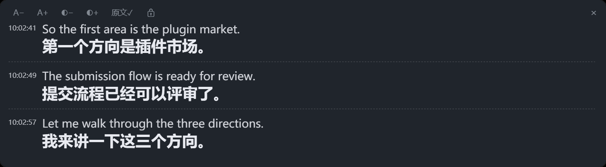
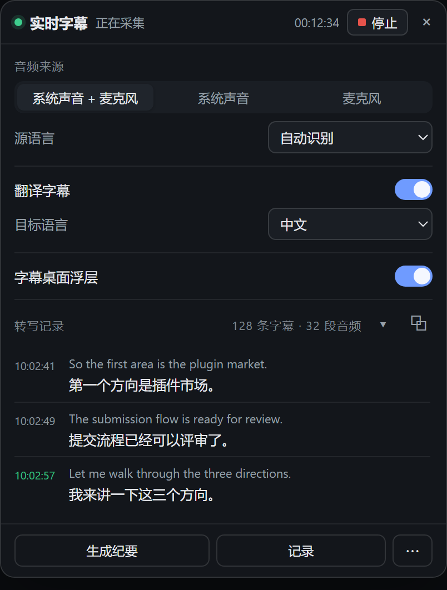

# dsh-live-captions · Live captions

**English** · [简体中文](README.zh.md)

Real-time multilingual subtitles from the audio your computer plays and your microphone: recognised on this machine, translated line by line, floated above every window, and turned into meeting minutes when the call ends.



> Windows x64 only: capture uses the WASAPI loopback, and the overlay is a PowerShell + WPF window. Everything else — the panel, the recognition model, translation, minutes and records — runs inside DeepSeek Harness.

## Contents

- [Features](#features)
- [Requirements](#requirements)
- [Installation](#installation)
- [Quick start](#quick-start)
- [The panel](#the-panel)
- [Desktop overlay](#desktop-overlay)
- [Translation engines](#translation-engines)
- [Records](#records)
- [Meeting minutes](#meeting-minutes)
- [First run and downloads](#first-run-and-downloads)
- [Data and privacy](#data-and-privacy)
- [Latency and segmentation](#latency-and-segmentation)
- [Configuration](#configuration)
- [File locations](#file-locations)
- [Troubleshooting](#troubleshooting)
- [Limitations](#limitations)
- [Development](#development)
- [License](#license)

## Features

- **Two audio sources**: the default Windows speaker (WASAPI loopback) and the default microphone — either one alone, or both mixed.
- **Recognition on this machine**: SenseVoiceSmall + Silero VAD run on your CPU; audio never leaves the machine. The ~230 MB model **downloads in the background as soon as the plugin is active**, then stays cached locally.
- **Live captions**: a segment ends at a real pause; while you are still talking, the audio received so far is recognised every 1.5 seconds, so the first sentence appears after about 2 seconds, and a hard-split half-sentence is merged back into the same line.
- **Many languages**: source language auto / Chinese / English / Cantonese / Japanese / Korean; subtitle language Chinese, English, Japanese, Korean, Cantonese, Spanish, French, German, Russian or Portuguese.
- **Three translation engines**: the cloud model, a built-in offline multilingual model, or an OpenAI-compatible server you run yourself.
- **System always-on-top overlay**: a separate borderless window above every application, still visible when DeepSeek Harness is minimised, opened automatically when capture starts.
- **Meeting minutes**: the transcript and a minutes prompt are put into a new session, and the current model summarises them as overview / topics / conclusions / action items / risks and open questions.
- **Agent tool**: `live_captions` lets the model start and stop captions, read the state, browse records and generate minutes.

## Requirements

| Item | Requirement |
|---|---|
| OS | **Windows 10 / 11 x64** — capture uses the system WASAPI loopback and the overlay is a PowerShell + WPF window |
| DeepSeek Harness | `>= 0.2.2-rc.1`, desktop build or any build with the browser UI |
| Speech recognition | The host's speech-to-text service and SenseVoice provider; the plugin's patch inserts both rows for you |
| Disk | ~230 MB for the recognition model; another 90–640 MB for an offline translation model |

**macOS and Linux are not supported**: both loopback capture and the always-on-top window are Windows implementations, so pressing "Start" elsewhere returns an explanation. The panel, translation, minutes and records are platform-neutral; a port would need a new capture backend and a new overlay, and the host would have to ship an ONNX runtime for that platform.

Disable the bundled (or any other) **Voice input** plugin before enabling this one: both register the same speech service, and whichever starts second fails.

## Installation

Install it from the plugin market by searching for "Live captions", or from Settings → Plugins by package name, or with the CLI:

```sh
dsh plugin add dsh-live-captions
```

Once it is installed and enabled, a "Live captions" pill appears at the bottom right of the UI and the recognition model starts downloading in the background — the pill and the panel both show the percentage.

## Quick start

1. Click the "Live captions" pill at the bottom right to open the panel (on windows narrower than 1100 px the pill moves up above the composer).
2. "Audio source" starts at "System audio + mic", the source language at auto-detect and the subtitle language at Chinese; usually nothing needs changing.
3. Press "Start". If the model is still downloading, capture waits for it and begins on its own.
4. The desktop overlay opens by itself and captions appear as people speak. Press its × if you do not want it — recording continues.
5. Press "Stop" when the meeting ends, then "Minutes".



## The panel

| Area | Contents |
|---|---|
| Header | Title, status (preparing the model / capturing / error…), elapsed time, "Stop" or "Start", and × to collapse the panel |
| Audio source | System audio + mic / System audio / Microphone — can be changed while capturing |
| Source language | Auto detect / Chinese / English / Cantonese / Japanese / Korean |
| Translate | Switch; when on, a "Subtitle language" dropdown appears, when off a muted note explains it |
| Desktop overlay | Switch; while the overlay is locked an "Unlock" button sits here, and after closing the overlay this is the only way back |
| Transcript | Right side of the heading shows "lines · segments", ▾/▸ to fold it and ⧉ for a detached window; **folded by default** |
| Footer | "Minutes", "Records" and "⋯"; "⋯" opens the advanced group (translation engine, model, offline model download, local server address, keep audio) |

## Desktop overlay

The overlay is a **real system always-on-top window** (PowerShell + WPF, not in the taskbar). It polls the plugin's own API for captions, closes when the host exits, and never leaves an orphan window behind.

- **Opens automatically when capture starts**, so it does not have to be switched on before every meeting. Closing it with × only hides it; reopen it from the panel's "Desktop overlay" switch (opening it manually shows it immediately, with "Overlay ready — captions appear once capture starts").
- **Two lines per caption**: a smaller, muted source line and a larger bold translation, each with a time code on the left. Turning off "Source" in the tool row leaves just the translation.
- **Tool row** (left to right): `A−` / `A+` font size, `◐−` / `◐+` opacity, `Source` to show or hide the source line, `🔒` lock, and `×` to close at the top right.
- **Drag anywhere**: the caption body and the empty part of the tool row both move the whole box; only the buttons themselves ignore the drag.
- **Resize** from every edge and corner (a 10 px band, with a resize cursor), down to 320 × 140.
- **Default size follows the font size**: 748 × 235 at the default 22 px, horizontally centred and about 12 % above the bottom, clamped back on screen when it would land outside. Position and size are remembered in `settings.json` in DIPs and survive restarts.
- **Scroll wheel** moves back through earlier sentences; new captions stop pulling the view once you have scrolled up, and a "↓ Back to live" badge appears.
- **Locking makes it click-through**: the box stops receiving mouse events and no longer covers the window underneath. Unlock from the panel — the tool row's own button is unreachable while locked.
- **Closing the overlay does not stop recognition**: the transcript, records and minutes keep working.
- **Detached transcript window** (⧉ in the transcript heading): a draggable, resizable window that refreshes while the meeting runs, so the transcript stays readable with the panel closed.

## Translation engines

Pick one of three under "⋯"; the choice is stored in `settings.json` and reused next time. **The engine and model can be chosen while translation is off**, and take effect as soon as it is switched on.

- **Cloud model** (default): the list comes from the model providers registered in your dsh (`provider · model`), or leave it on "Follow the dsh default". Best quality, needs the network.
- **Offline model**: three built-in choices, all running locally:

  | Model | Size | License | Notes |
  |---|---|---|---|
  | `Xenova/m2m100_418M` | ≈600 MB | MIT | Multilingual both ways across zh/en/ja/ko/yue/es/fr/de/ru/pt; the default |
  | `Xenova/nllb-200-distilled-600M` | ≈640 MB | CC-BY-NC 4.0 (non-commercial) | Better Chinese and Cantonese |
  | `Xenova/opus-mt-en-zh` | ≈90 MB | Apache-2.0 | English → Chinese only, the smallest and fastest |

  The dropdown's right-hand slot is the download state: "Download" when it has never been fetched, a spinner with percentage and "Cancel" while downloading (cancelling kills the process and throws away the half-written weights), and a ✓ once ready. Weights are downloaded once, stored in the plugin's data directory, and work offline afterwards. **A failed or stalled download names the full URL of the file it was fetching**, so the cause — blocked network, dead mirror, or interception — is visible.
- **Local server**: an OpenAI-compatible service you run yourself; give it an address and a model name, for example Ollama (`http://127.0.0.1:11434/v1`), LM Studio (`http://127.0.0.1:1234/v1`) or vLLM.

An unavailable local or offline engine **never falls back to the cloud silently** (privacy first) — the panel shows the failure instead. Translation is skipped in only two cases: the source language is explicitly the same as the subtitle language, or the source language is auto, the recognised text is Chinese, and the subtitle language is Chinese or Cantonese.

Offline translation runs in a **separate child process** (ONNX Runtime is a native dependency, so isolating it keeps a crash from taking dsh down). See `lib/mt-server.js` and, for the model list and language-code mapping, `lib/mt-models.js`.

## Records

"Records" opens the caption record dialog:

- Each session appears as `2026-11-20 21:31:00 · 30m · 12 lines` (start time, duration, line count).
- The body lists source and translation with `h:mm:ss` codes, and "Copy all" copies everything.
- A single session can be deleted; deleting the current one clears it — the panel list and the on-disk transcript both go, while sequence numbers stay monotonic so later captions never jump back in time.

## Meeting minutes

The "Minutes" button **does not quietly run a model inside the plugin**. It opens a new session with this session's transcript (time-coded) and a minutes prompt already in the composer: pressing Enter hands it to the current model, and the result can be followed up, rewritten or exported. The prompt fixes the structure (overview / topics / conclusions / action-items table / risks and open questions), demands that only information present in the transcript is used, and asks for "to confirm" wherever the transcript is unclear; a very long transcript is truncated with a note.

The agent tool's `minutes` action takes another route: the plugin generates the minutes itself, writes `minutes/<session>-minutes.md` and returns the text.

## First run and downloads

| What | Size | When | Afterwards |
|---|---|---|---|
| Recognition model (SenseVoice + VAD) | ≈230 MB | **Automatically once the plugin is active**, in the background, through hf-mirror in mainland China | Cached locally, no further network |
| Built-in offline translation model | 90 / 600 / 640 MB | Only when "Download" is pressed under "Translation engine → Offline model" | Cached locally, usable offline |
| `@huggingface/transformers` | — | Installed on demand the first time offline translation is used | Installed into the plugin's data directory |

While the recognition model downloads, the panel shows a card (title, progress bar, percentage, "About 230 MB, one time only"), and the collapsed pill shows the percentage too — 230 MB never arrives silently. Pressing "Start" early is fine: capture waits for the download and then begins.

## Data and privacy

| Data | Where it goes |
|---|---|
| Captured audio | Written to a temporary local WAV and **deleted as soon as it has been recognised** (about 1.2 GB per hour of meeting); turn on "⋯ → Keep audio" to keep the segments in the session's `segments/` folder |
| Recognition | Your CPU (SenseVoice); never uploaded |
| Translations | With the cloud engine, the caption text goes to the configured model service; with the offline model or your own server it stays on the machine |
| Transcripts, minutes, settings, caches | `~/.dsh/live-captions/`, on this machine only |

No model weights ship inside the package, which keeps the plugin small; the models are the downloads listed above.

## Latency and segmentation

- **Source text**: about 0.5 s after a pause the first version appears; while a sentence is still being spoken the audio received so far is recognised every 1.5 s, so **the first sentence is on screen after about 2 s** and fills in as you keep talking. When the segment really ends, the final text **replaces that same line** rather than adding a second one.
- **Translation**: the cloud model takes about 1–2 s per sentence and keeps up with the source; the built-in offline model needs 4–6 s per sentence on CPU, so with many sentences it queues and falls behind speech; a self-hosted server depends on that machine. Use the cloud model when latency matters.
- **Segmentation** prefers places where speech **really stops**: a pause means no syllable-level peak at all in the last 600 ms (threshold at 7 % of the speech level, roughly −23 dB), so the tens of milliseconds of low energy inside a breath or a voiceless consonant do not count. When speech never stops (background music, continuous talking) the hard cut at the 8-second limit moves to **the quietest 400 ms gap in the previous 3 seconds**, preferring the later one, which tends to land between clauses or at a breath. Only a segment whose peak stays below 0.0012 is discarded as silence, so quiet speech survives.
- **A hard-split pair is merged back into one caption**: if the cut is still loud, the sentence was not finished, so the next segment is **merged into the previous caption** (no extra line), the period added at the cut is removed and the time code stays at the start of the sentence. A cut that really lands in silence starts a new line. The translation waits for the sentence to finish (up to 8 seconds). Each caption is merged at most once, so nothing grows into a paragraph.
- When the spoken language equals the subtitle language, no model is called and only recognition latency remains.

These segmentation settings (the 8-second cap, the 600 ms pause test, the quietest 400 ms gap within 3 seconds) are defaults tuned on real low-volume, noisy audio; the panel does not expose them.

## Configuration

Configuration lives on the `live-captions` row of `cordis.patch.yml`:

| Key | Default | Meaning |
|---|---|---|
| `dataRoot` | `~/.dsh/live-captions` | Where transcripts, minutes, logs and caches go |
| `source` | `both` | `both` / `speaker` / `mic` |
| `sourceLanguage` | `auto` | `auto` / `zh` / `en` / `yue` / `ja` / `ko` |
| `targetLanguage` | `zh` | Subtitle language |
| `translate` | `true` | Translate or not |
| `translateEngine` | `cloud` | `cloud` / `builtin` / `local` |
| `minSegmentSeconds` | `1.2` | Shortest segment; filters coughs and other short noises |
| `keepAudio` | `false` | Keep each segment (also switchable from the panel: "⋯ → Keep audio") |
| `localBaseUrl` / `localModel` | Ollama defaults | Your own OpenAI-compatible service |

Source, languages and engine can also be changed in the panel; the change is written to `dataRoot/settings.json` and overrides these defaults.

## File locations

| What | Where |
|---|---|
| Transcript | `~/.dsh/live-captions/sessions/<time>/transcript.jsonl` |
| Kept audio (only with "Keep audio") | `~/.dsh/live-captions/sessions/<time>/segments/*.wav` |
| Minutes generated by the agent tool | `~/.dsh/live-captions/minutes/<time>-minutes.md` |
| Runtime log | `~/.dsh/live-captions/logs/live-captions.log` |
| Settings changed in the panel | `~/.dsh/live-captions/settings.json` |
| Built-in translation model cache | `~/.dsh/live-captions/models/mt` |
| Recognition model cache | `~/.dsh/speech-to-text/sensevoice/models` (managed by the host's SenseVoice provider) |

Earlier versions wrote to `~/.dsh/meeting-captions`; on the first start after upgrading, the whole directory is moved to `~/.dsh/live-captions`, history and settings included.

## Troubleshooting

**The panel says "speech recognition service not loaded" and Start does nothing.**
The host did not load the speech-to-text service. Check that the plugin is enabled (its patch inserts both rows) and disable the bundled Voice input plugin — the two compete for the same service.

**The recognition model downloads slowly or fails.**
The error names the full URL it was fetching, which tells you whether the network, the mirror or an interception is at fault. The download only happens once; after an interruption, re-enabling the plugin (or calling the `live_captions` tool's `prepare`) continues it.

**Capture runs but no captions appear.**
If the panel reports that no sound has been detected yet, check in order: system volume at zero, the video muted, the microphone permission, and whether "Audio source" is right (on a laptop's speakers "System audio" is much cleaner than "Microphone").

**Captions lag noticeably.**
Decide whether the source text or the translation lags: a slow source is usually low volume or the wrong source language; a slow translation is almost always the built-in offline model (4–6 s per sentence on CPU, and it queues) — switch to the cloud model.

**The overlay was closed by mistake.**
Panel → "Desktop overlay" switch. A locked overlay is also unlocked there.

**The overlay ended up off screen.**
The window is clamped back into the visible area; failing that, delete `lyricX` / `lyricY` / `lyricW` / `lyricH` from `settings.json` to return to the size derived from the font.

**Does it work on macOS or Linux?**
No — see [Requirements](#requirements).

## Limitations

- **Windows x64 only**, and it needs the system PowerShell (both the overlay and the capture helper are started through it).
- Recognition depends on the host's `@deepseek-ai/dsh-experimental-speech-to-text` and SenseVoice provider; without them the panel reports an error.
- With loud background music and almost no pauses, a cut can still land mid-word: the next half is merged into the same caption, but the one or two characters at the cut may be misrecognised.
- Recognition quality depends on volume: at very low system volume the error rate rises; "Audio source → System audio" reduces room noise.
- The built-in translation model's dependency `@huggingface/transformers` **is not installed with the plugin**; it is installed on demand (needs npm/pnpm on the machine) only when the offline engine is chosen. Cloud translation, recognition and minutes are unaffected.
- Disabling the plugin stops capture and ends the current session; transcripts and minutes already written are kept.

## Development

```sh
node .test/client-check.mjs        # load the client bundle, render once, compare both dictionaries
node .test/mt-process-check.mjs    # drive the built-in translation child process
node .test/mock-local-llm.cjs 11434 # a fake OpenAI-compatible server, for the "local server" engine
```

Model weights (`models/`) exist only in a source checkout — they are **not in the repository and not in the npm package**; when present they are copied into the host's recognition model cache on first use, saving a download. Model attributions and licenses are in `docs/MODEL-NOTICE.md`.

## License

MIT. Third-party model weights are covered by [docs/MODEL-NOTICE.md](docs/MODEL-NOTICE.md).
