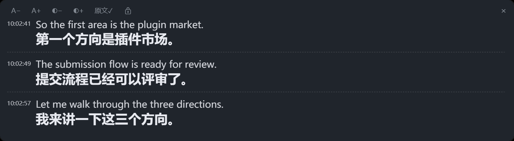
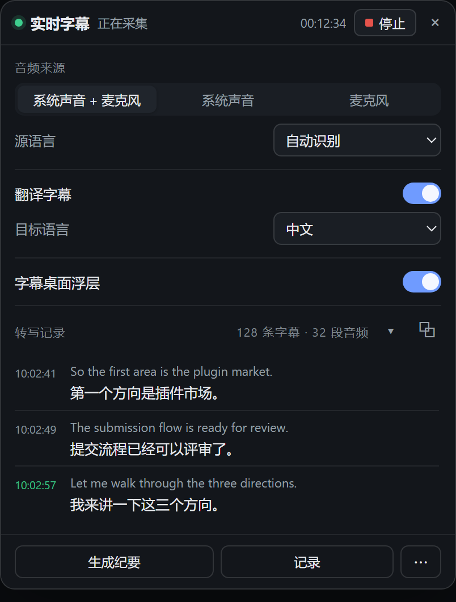

# dsh-live-captions · 实时字幕

[English](README.md) · **简体中文**

把电脑正在播放的声音和麦克风变成实时多语言字幕：本机识别、逐句翻译、字幕浮在系统最上层，会议结束还能一键生成纪要。



> 仅支持 Windows x64：采集用 WASAPI 环回，浮层是 PowerShell + WPF 窗口；其余部分（面板、识别、翻译、纪要、记录）都在 DeepSeek Harness 里。

## 目录

- [功能](#功能)
- [系统要求](#系统要求)
- [安装](#安装)
- [快速开始](#快速开始)
- [面板](#面板)
- [字幕桌面浮层](#字幕桌面浮层)
- [翻译引擎](#翻译引擎)
- [字幕记录](#字幕记录)
- [生成纪要](#生成纪要)
- [首次使用与下载](#首次使用与下载)
- [数据与隐私](#数据与隐私)
- [延迟与断句](#延迟与断句)
- [配置](#配置)
- [文件位置](#文件位置)
- [常见问题](#常见问题)
- [限制](#限制)
- [开发](#开发)
- [许可](#许可)

## 功能

- **两个声音来源**：Windows 默认扬声器（WASAPI 环回）和默认麦克风，可以只用其一，也可以混在一起采。
- **本机识别**：SenseVoiceSmall + Silero VAD 在你的 CPU 上跑，音频不出机器。识别模型约 230 MB，**插件启用后自动在后台下载**，下完缓存在本机。
- **实时字幕**：说话一停就切段；话还没说完时每 1.5 秒先把已收到的音频识别一次，所以第一句大约 2 秒就能上屏；被硬切断的半句会接回同一行。
- **多语言**：源语言可选自动/中文/英文/粤语/日文/韩文；目标语言可选中文、英文、日文、韩文、粤语、西班牙文、法文、德文、俄文、葡萄牙文。
- **三种翻译引擎**：云端大模型、插件内置的离线多语种模型、你自己跑的 OpenAI 兼容服务。
- **系统置顶浮层**：独立的无边框窗口，盖在任何应用之上，最小化 DeepSeek Harness 也不会消失；开始采集时自动出现。
- **会议纪要**：把整段转写和纪要提示词放进一个新会话，由当前模型总结成「会议概要 / 主要议题 / 关键结论 / 待办事项 / 风险与待确认」。
- **agent 工具**：`live_captions` 让模型也能开始/停止字幕、查状态、看记录、生成纪要。

## 系统要求

| 项目 | 要求 |
|---|---|
| 操作系统 | **Windows 10 / 11 x64**（采集依赖系统自带的 WASAPI 环回，浮层是 PowerShell + WPF 窗口） |
| DeepSeek Harness | `>= 0.2.2-rc.1`，桌面版或带浏览器界面的运行方式 |
| 语音识别 | 由宿主自带的 speech-to-text 服务与 SenseVoice provider 提供，插件的 patch 会自动插入这两行 |
| 磁盘 | 识别模型约 230 MB；内置离线翻译模型另需 90–640 MB |

**macOS / Linux 目前不支持**：系统声音的环回采集和系统置顶窗口都是 Windows 实现，其他系统上点「开始」会直接给出说明。面板、翻译、纪要、记录本身与平台无关，移植需要另写采集端与浮层，识别还得宿主在对应平台提供 ONNX 运行时。

安装或启用前请先关掉自带（或另一个）**「语音输入 / Voice input」**插件：它和本插件注册同一个语音识别服务，后启用的那个会失败。

## 安装

在插件市场里搜索「实时字幕 / Live captions」安装，或者在设置 → 插件里用包名安装：

```sh
dsh plugin add dsh-live-captions
```

装好并启用后，右下角会出现「实时字幕」胶囊；识别模型开始后台下载，胶囊和面板里都能看到百分比。

## 快速开始

1. 点界面右下角的「实时字幕」胶囊打开面板（窗口宽度 ≤1100px 时胶囊会自动上移到输入框上方）。
2. 「音频来源」默认是「系统声音 + 麦克风」，「源语言」默认自动识别，「目标语言」默认中文；一般不用改。
3. 点「开始」。识别模型还没下完的话，会等它下完再自动开始采集。
4. 桌面浮层自动出现，边说话边出字幕。浮层不想要就点它右上角的 ×，字幕照常记录。
5. 结束后点「停止」，再点「生成纪要」。



## 面板

| 位置 | 内容 |
|---|---|
| 顶部 | 标题、状态（正在准备模型 / 正在采集 / 出错…）、计时、「停止」或「开始」、「×」收起面板 |
| 音频来源 | 系统声音 + 麦克风 / 系统声音 / 麦克风，采集过程中也能切 |
| 源语言 | 自动识别 / 中文 / 英文 / 粤语 / 日文 / 韩文 |
| 翻译字幕 | 开关；打开后多一行「目标语言」下拉框，关掉时显示灰字说明 |
| 字幕桌面浮层 | 开关；锁定状态下这里会出现「解锁」按钮，关闭浮层后这里是唯一的重新打开入口 |
| 转写记录 | 标题右边是「条数 · 段音频」、▾/▸ 折叠、⧉ 弹出独立窗口；**默认折叠** |
| 底部 | 「生成纪要」「记录」「⋯」三个按钮，「⋯」展开更多设置（翻译引擎、模型、离线模型下载、本地服务地址、是否保留音频） |

## 字幕桌面浮层

浮层是一个**真正的系统置顶窗口**（PowerShell + WPF，不占任务栏），轮询插件自己的 API 取字幕，宿主退出后自动关闭，不留孤儿窗口。

- **开始采集时自动打开**，不用每次手动开。点浮层右上角的 × 关掉后，字幕照常识别记录，需要时在面板「字幕桌面浮层」开关重新打开（手动打开会立刻显示，还没开始采集时写「浮层已就绪，开始采集后显示字幕」）。
- **两行一句**：上一行小一号、次要颜色是原文，下一行大号加粗是译文，每句左边带时间码。关掉工具条上的「原文✓」就只剩译文。
- **工具条**（左上到右上）：`A−` / `A+` 字号、`◐−` / `◐+` 透明度、`原文✓` 是否显示原文行、`🔒` 锁定、`×` 关闭（在右上角）。
- **拖动**：正文和工具条那一行的空白处都能拖整个框；只有按钮本身不响应拖动。
- **缩放**：四条边、四个角都能拖（10px 边缘，鼠标移到边缘会变成拉伸光标），最窄 320、最矮 140。
- **默认尺寸按字号推算**：22 号字下是 748×235，位置水平居中、距窗口底部约 12%，超出屏幕会自动夹回可见区域。拖动或缩放后按 DIP 记在 `settings.json`，重启保留。
- **滚轮**上下翻看前面的句子；滚上去后新字幕不会把视图顶走，左上角出现「↓ 回到最新」。
- **锁定后点击穿透**：框体不再接收鼠标事件，不会挡住下面的窗口；解锁在面板里（工具条上的「解锁」在锁定时无法点）。
- **关闭浮层不影响识别**：只是不再浮在屏幕上，转写、记录、纪要一切照旧。
- **⧉ 独立实时转写窗口**：面板「转写记录」标题右边的按钮会弹出一个可拖动、可缩放的窗口，边开会边刷新，关掉面板也能一直看。

## 翻译引擎

面板「⋯」里三选一，选择保存在 `settings.json`，下次启动沿用。**即使「翻译字幕」关着也能先选好引擎和模型**，打开翻译时直接生效。

- **云端大模型**（默认）：列表来自当前 dsh 已注册的模型提供方（`provider · model`），也可以留空「跟随 dsh 默认模型」。质量最好，需要联网。
- **离线模型**：三个内置选项，全部本机跑、不联网：

  | 模型 | 体积 | 许可 | 说明 |
  |---|---|---|---|
  | `Xenova/m2m100_418M` | ≈600 MB | MIT | 多语种互译，中英日韩粤西法德俄葡，默认项 |
  | `Xenova/nllb-200-distilled-600M` | ≈640 MB | CC-BY-NC 4.0（非商用） | 中文、粤语质量更好 |
  | `Xenova/opus-mt-en-zh` | ≈90 MB | Apache-2.0 | 只做英文→中文，最快最省 |

  下拉框右侧是下载/状态位：没下过显示「下载」，下载中显示转圈、百分比和「取消」（取消会结束进程，丢掉这次写了一半的权重，下次重下），就绪后变成 ✓。权重只下一次，存在插件数据目录，之后离线可用。**下载失败或停滞时，错误信息里会直接给出正在下载的那个文件的完整 URL**，方便判断是网络不通、镜像失效还是被拦。
- **本地推理服务**：你自己跑的 OpenAI 兼容服务，填地址和模型名即可，例如 Ollama（`http://127.0.0.1:11434/v1`）、LM Studio（`http://127.0.0.1:1234/v1`）、vLLM。

本地/离线引擎不可用时**不会偷偷回退到云端**（隐私优先），面板会显示失败原因。只有两种情况会跳过翻译：源语言显式设成和目标语言相同，或者源语言是「自动」、识别结果是汉字、目标语言是中文/粤语。

离线翻译跑在**独立子进程**里（ONNX Runtime 是原生依赖，隔离后它崩溃也不会带走 dsh），源码见 `lib/mt-server.js`，模型清单与语言码映射见 `lib/mt-models.js`。

## 字幕记录

面板「记录」打开字幕记录弹窗：

- 下拉框里每次会话显示为 `2026-11-20 21:31:00 · 30m · 12 条`（开始时间、持续时长、条数）。
- 正文按 `时:分:秒` 列出原文与译文，可「复制全部」。
- 可以删除单个会话；删除当前会话等于清空它：面板列表和磁盘上的转写一起清掉，序列号保持单调，之后的字幕时间戳不会跳回去。

## 生成纪要

面板底部的「生成纪要」**不在插件里偷偷跑模型**，而是打开一个新会话，把本次转写（带时间码）和纪要提示词一起放进输入框：直接回车交给当前会话的模型总结，之后可以继续追问、改写、导出。提示词固定了结构（会议概要 / 主要议题 / 关键结论 / 待办事项表格 / 风险与待确认），要求只用转写里出现的信息，无法确定的一律写「待确认」；转写极长时会截断并注明。

agent 工具里的 `minutes` 动作走另一条路：直接让插件生成纪要，写入 `minutes/<会话>-minutes.md` 并返回文本。

## 首次使用与下载

| 内容 | 体积 | 什么时候下载 | 下载后 |
|---|---|---|---|
| 识别模型（SenseVoice + VAD） | ≈230 MB | **插件启用后自动**，后台进行，国内走 hf-mirror | 本机缓存，之后不再联网 |
| 内置离线翻译模型 | 90 / 600 / 640 MB | 只在「翻译引擎 → 离线模型」里主动点「下载」 | 本机缓存，可离线用 |
| `@huggingface/transformers` | — | 第一次用离线翻译时按需安装 | 装进插件数据目录 |

识别模型下载时，面板会显示一张卡片（标题、进度条、百分比、说明「约 230 MB，只需要下载这一次」），面板收起时胶囊上也显示百分比，不会在后台悄悄拉 230 MB 却毫无提示。还没下完就点「开始」也没关系：会等下载完成再自动开始采集。

## 数据与隐私

| 数据 | 去哪了 |
|---|---|
| 采集到的音频 | 只写进本机临时 WAV，**默认识别成功后立刻删除**（一小时会议约 1.2 GB）；需要留存时打开面板「⋯ → 保留音频」，音频会留在该会话的 `segments/` 目录里 |
| 原文识别 | 你的 CPU（SenseVoice），不上传 |
| 译文 | 选了云端模型时，字幕文本发给当前配置的模型服务；选内置离线模型或自建服务时不出机器 |
| 转写、纪要、设置、缓存 | `~/.dsh/live-captions/`，只在本机 |

安装包里不带任何模型权重，所以插件本身很小；模型都是上面那些按需下载。

## 延迟与断句

- **原文**：停顿后约 0.5 秒出第一版；一段话还在说的时候，每 1.5 秒会把已收到的音频识别一次，**第一句大约 2 秒上屏**，随后逐字补全；这段真正结束时，最后一版文字**原地替换**这一行，不会重复出两行。
- **译文**：云端模型每个分句约 1–2 秒，能跟着原文刷新；内置离线模型在 CPU 上每句 4–6 秒，句数一多会排队，跟不上说话速度；自建服务取决于那台机器。要低延迟就用「云端大模型」。
- **断句**：优先在**真正停下来**的地方切——最近 600 ms 里连一个音节级的峰值都没有才算停顿（阈值取说话音量的 7%，约 -23 dB），换气、清辅音那种几十毫秒的低能量凹陷不算。停不下来（背景音乐、连续说话）时，8 秒上限处的硬切会挪到最近 3 秒里**最安静的 400 ms 空隙**，优先靠后的那个，尽量落在分句和换气的位置。整段峰值低于 0.0012 才当静音丢弃，轻声说话不会被误扔。
- **硬切开的两半会接回同一句**：切点还比较响说明话没说完，下一段会**合并进上一条字幕**（不新增一行），去掉切点上硬加的句号，时间码保持该句开头；切点真落在安静空隙里就算新起一行。译文等这句话说完再翻（最多等 8 秒）。每条最多合并一次，不会滚成一大段。
- 字幕语言和说话语言相同时不会调用模型翻译，只剩识别延迟。

这些切段参数（8 秒上限、600 ms 停顿判定、3 秒内最安静的 400 ms 空隙）是按低音量、带背景音的实测音频调好的默认值，面板里不提供调节。

## 配置

插件配置在 `cordis.patch.yml` 的 `live-captions` 行：

| 键 | 默认值 | 说明 |
|---|---|---|
| `dataRoot` | `~/.dsh/live-captions` | 转写、纪要、日志和缓存的位置 |
| `source` | `both` | `both` / `speaker` / `mic` |
| `sourceLanguage` | `auto` | `auto` / `zh` / `en` / `yue` / `ja` / `ko` |
| `targetLanguage` | `zh` | 字幕语言 |
| `translate` | `true` | 是否翻译 |
| `translateEngine` | `cloud` | `cloud` / `builtin` / `local` |
| `minSegmentSeconds` | `1.2` | 最短段，过滤咳嗽这类短噪声 |
| `keepAudio` | `false` | 是否保留每段音频（面板「⋯ → 保留音频」也能改） |
| `localBaseUrl` / `localModel` | Ollama 默认 | 自建 OpenAI 兼容服务 |

运行中的来源、语言、引擎也能直接在面板里改，改动写进 `dataRoot/settings.json`，覆盖这里的默认值。

## 文件位置

| 内容 | 路径 |
|---|---|
| 转写 | `~/.dsh/live-captions/sessions/<时间>/transcript.jsonl` |
| 保留下来的音频（开了「保留音频」才有） | `~/.dsh/live-captions/sessions/<时间>/segments/*.wav` |
| 纪要（agent 工具生成） | `~/.dsh/live-captions/minutes/<时间>-minutes.md` |
| 运行日志 | `~/.dsh/live-captions/logs/live-captions.log` |
| 面板改过的设置 | `~/.dsh/live-captions/settings.json` |
| 内置翻译模型缓存 | `~/.dsh/live-captions/models/mt` |
| 识别模型缓存 | `~/.dsh/speech-to-text/sensevoice/models`（由宿主的 SenseVoice provider 管理） |

旧版本把数据写在 `~/.dsh/meeting-captions`。升级后首次启动会把整个目录移到 `~/.dsh/live-captions`，历史记录和设置都在。

## 常见问题

**面板顶部显示「语音识别服务未加载」，开始按钮点不动。**
宿主没有加载 speech-to-text 服务。确认插件已启用（patch 会插入那两行），并关掉自带的「语音输入」插件——两者抢同一个服务。

**识别模型下载很慢或失败。**
错误信息里有正在下载的完整 URL，用它判断是网络、镜像还是被拦。下载只做一次，中断后重新启用插件（或让 agent 调用 `live_captions` 的 `prepare`）会接着来。

**点开始后一直没字幕。**
如果面板提示「还没检测到声音」，按顺序检查：系统音量是不是 0、视频是不是静音、麦克风权限、以及「音频来源」选得对不对（笔记本外放时「系统声音」比「麦克风」干净得多）。

**字幕有明显延迟。**
先看是原文慢还是译文慢：原文慢通常是音量低或源语言设错；译文慢几乎都是因为选了内置离线模型（CPU 上每句 4–6 秒，会排队），换成「云端大模型」即可。

**不小心把浮层关了，怎么回来。**
面板 →「字幕桌面浮层」开关，重新打开。浮层被锁定时也是在这里「解锁」。

**浮层位置跑到屏幕外了。**
插件会把窗口夹回可见区域；实在不行把 `settings.json` 里的 `lyricX` / `lyricY` / `lyricW` / `lyricH` 删掉，回到按字号自动适配。

**能用在 macOS 或 Linux 上吗？**
不能，见[系统要求](#系统要求)。

## 限制

- 只支持 **Windows x64**，且需要系统 PowerShell（浮层和采集辅助进程都由它启动）。
- 识别依赖宿主自带的 `@deepseek-ai/dsh-experimental-speech-to-text` 与 SenseVoice provider；宿主没有这两个包时面板会直接报错。
- 背景音乐很响、几乎没有停顿的音频里，切点仍可能落在词中间：后半句会合并回同一条字幕，但切点那一两个字仍可能识别成别的字。
- 识别质量取决于音量：系统音量过低时错字明显增加；可以改成「音频来源 → 仅系统声音」减少环境噪声。
- 内置翻译模型的依赖 `@huggingface/transformers` **不随插件安装**，只在选了「离线模型」时按需安装（需要本机有 npm/pnpm）。不影响云端翻译、识别和纪要。
- 关闭插件会停止采集并结束当前会话；已经写出的转写和纪要文件保留。

## 开发

```sh
node .test/client-check.mjs        # 加载 client 包、渲染一次、校验两份字典
node .test/mt-process-check.mjs    # 直接驱动内置翻译子进程
node .test/mock-local-llm.cjs 11434 # 假的 OpenAI 兼容服务，用来验证「本地推理服务」
```

模型权重（`models/`）只在源码检出里存在，**不进仓库、也不进 npm 包**；检出里存在时会在首次使用时复制到宿主的识别模型缓存，省掉一次下载。模型署名与许可见 `docs/MODEL-NOTICE.md`。

## 许可

MIT。第三方模型权重的许可见 [docs/MODEL-NOTICE.md](docs/MODEL-NOTICE.md)。
